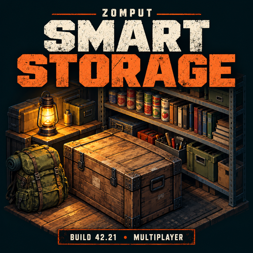
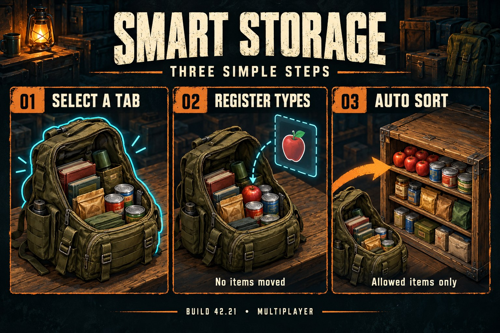

# Zomput-Smart_Storage

프로젝트 좀보이드 **Build 42.21 / 42.21.0**, 싱글 및 멀티플레이용 스마트 보관함 모드입니다.

**Mod ID:** `ZomputSmartStorage`

**필수 선행 모드:** [Better Sorting](https://steamcommunity.com/sharedfiles/filedetails/?id=2313387159) (`BetterSortCC`)

**Workshop ID:** `3820062699` · [스팀 창작마당](https://steamcommunity.com/sharedfiles/filedetails/?id=3820062699)

대표 이미지와 안내 이미지는 AI 생성 기능 일러스트입니다. 실제 게임 화면은 아닙니다. [원본 이미지와 생성 프롬프트](docs/ARTWORK.md) · [창작마당 설명 원문](docs/workshop-description.bbcode)

## 사용 방법

1. 내 인벤토리 창에서 정리할 탭을 선택합니다. 가방 탭을 보고 있다면 그 가방 안의 아이템만 대상입니다.
2. 책장·상자·서랍장·냉장고 같은 월드 컨테이너 바로 옆에서 오른쪽 보관함 창의 대상 탭을 선택합니다.
3. 보관함 창 상단의 **선반 등 보관함 이름 오른쪽에 있는 자동정리 버튼**을 누르면, 내 인벤토리의 선택한 탭에서 허용된 아이템을 기본 게임 전송 동작으로 옮깁니다. 우클릭 메뉴에는 설정만 표시됩니다.
4. 보관함을 우클릭해 **정리 아이템 설정**을 열고 내 아이템을 목록 안으로 드래그하면 그 아이템의 종류가 등록됩니다. 실제 아이템은 이동하거나 소비되지 않습니다.
5. 목록에서 종류를 선택하고 **선택한 정보 삭제**를 누르면 등록이 해제됩니다. 해당 종류의 아이템이 보관함 안에 남아 있으면 **“아이템을 빼주고 삭제해주세요.”**가 표시됩니다. 보관함 안의 가방 속 아이템도 검사합니다.

**간편 설정**에서 **분류명만 허용**을 선택하고 **적용**을 누르면 해당 분류 전체를 허용합니다. Better Sorting과 함께 로드된 전체 분류가 자동으로 표시됩니다. 총기·스킬북뿐 아니라 의류·공구·제작 재료 등 모든 로드된 분류와 다른 모드가 추가한 분류도 대상이며, 분류 이름은 현재 게임 언어를 따릅니다.

**개별 아이템 설정** 모드에서는 목록이 비어 있으면 종류 제한이 없고, 하나 이상 등록하면 등록된 종류만 새로 넣을 수 있습니다. **분류 모드**에서는 선택한 분류만 허용합니다. 두 규칙을 합치지 않으며, 기존 개별 목록은 보존했다가 개별 설정으로 돌아오면 다시 적용합니다. 분류 모드 중에는 개별 목록 편집이 잠깁니다. 분류나 모드를 바꾸려면 보관함을 먼저 비워야 합니다.

자동정리와 일반 드래그 이동에 같은 규칙이 적용됩니다. 이미 들어 있는 아이템은 자유롭게 꺼낼 수 있습니다. 액체 용기와 녹화 영상은 Better Sorting의 현재 내용물 분류를 사용합니다. 선택한 분류가 모드 업데이트로 없어지면 새 입고를 차단하며, 보관함을 비운 뒤 다른 분류로 변경할 수 있습니다.

등록은 개별 물건의 ID가 아닌 `모듈.아이템종류` 기준입니다. 예를 들어 사과 하나를 등록하면 같은 종류의 사과를 넣을 수 있습니다. 상태·내구도·이름은 구분하지 않습니다. 가방 자체를 등록하면 그 가방 종류가 허용되며, 가방 내부의 아이템 종류까지 제한하는 기능은 아닙니다.

## 보호 동작

- 즐겨찾기, 착용, 손에 든 아이템과 제작에 소비된 아이템은 자동정리에서 제외합니다.
- 선택한 탭 바로 아래의 아이템만 정리합니다. 다른 가방을 재귀적으로 비우지 않습니다.
- 용량을 미리 계산하고, 최종 이동은 게임의 기본 전송 시스템에서 다시 검사합니다. 다른 사용자가 용량을 채우거나 설정을 변경하면 일부 예약은 취소될 수 있습니다. 완료 알림이 아닌 **이동 예약 수**를 표시합니다.
- 컨테이너별 설정을 서버가 저장하고 검증합니다. 다른 사용자가 먼저 수정한 설정을 덮어쓰지 않으며 새 목록에서 재시도하도록 안내합니다.
- 거리·층·벽·창문·보호구역·사망·사라진 컨테이너를 검사합니다. 현재 소유한 아이템으로만 등록할 수 있습니다.
- 중복 등록은 한 번만 저장합니다. 최대 128종, 드래그 한 번당 64종으로 제한합니다.
- 여러 구획을 가진 가구는 구획마다 설정이 독립적입니다. 바닥, 시체, 차량, 휴대용 가방 자체에는 설정 메뉴를 제공하지 않습니다.
- 기존 컨테이너의 종류·아이템 허용 콜백은 유지하며 마지막 규칙을 지우면 이전 콜백을 복원합니다.

## 설치

Better Sorting을 먼저 구독하고 함께 활성화하세요. 로컬 설치는 `Contents/mods/ZomputSmartStorage` 폴더를 게임 사용자 폴더의 `Zomboid/mods/` 아래에 복사합니다. 멀티에서는 서버와 접속 클라이언트 모두 두 모드의 같은 버전이 필요합니다. 서버 설정에는 `Mods=BetterSortCC;ZomputSmartStorage`, `WorkshopItems=2313387159;3820062699`를 추가합니다. 이미 다른 모드가 있다면 기존 목록에 두 항목을 더하세요.

자동화 배포 파일에는 사용자별 경로, 서버 주소, 인증 정보가 필요하지 않습니다. 이 저장소에는 모드 소스·설명·테스트·배포 패키지 생성 도구만 포함합니다.

## 검증 범위

Lua 5.1에서 실제 모드 로직을 실행하는 자동 테스트는 규칙 등록·삭제·동시 변경·접근 검사·선택 탭·용량·보호 아이템·드래그의 비이동 동작을 확인합니다. 게임 경계에는 모의 객체를 사용합니다. 실제 엔진 및 두 클라이언트 검증은 [테스트 체크리스트](docs/TESTING.md)에 별도로 기록합니다.

## 호환 범위

이 버전의 설정 대상은 월드에 설치된 가구 컨테이너입니다. 아이템을 직접 생성하거나 `AddItem`으로 강제 이동하는 다른 모드의 기능은 기본 전송 검사를 우회할 수 있습니다. 가구를 들어서 재설치했을 때 설정을 휴대하는 기능은 제공하지 않으므로 설치 후 설정을 다시 확인하세요. 모드를 제거하면 종류 제한은 해제되지만 가구의 모드 설정 데이터는 세이브에 남을 수 있습니다.

게임 코드의 확인 기준은 설치된 Build 42.21 Lua 및 `ItemContainer.isItemAllowed` / `setAcceptItemFunction` API입니다. 원본 게임 파일은 이 저장소에 포함하지 않습니다. API 참고: [The Indie Stone ItemContainer 문서](https://projectzomboid.com/modding/zombie/inventory/ItemContainer.html).
